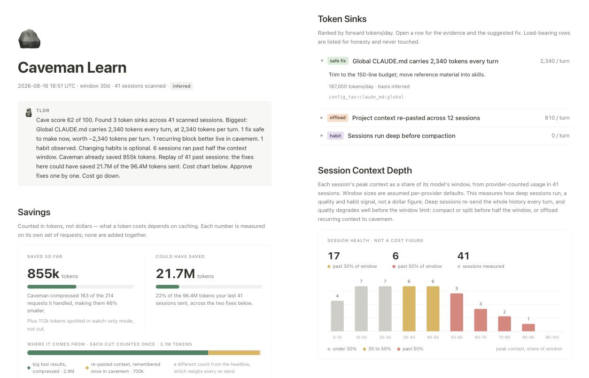
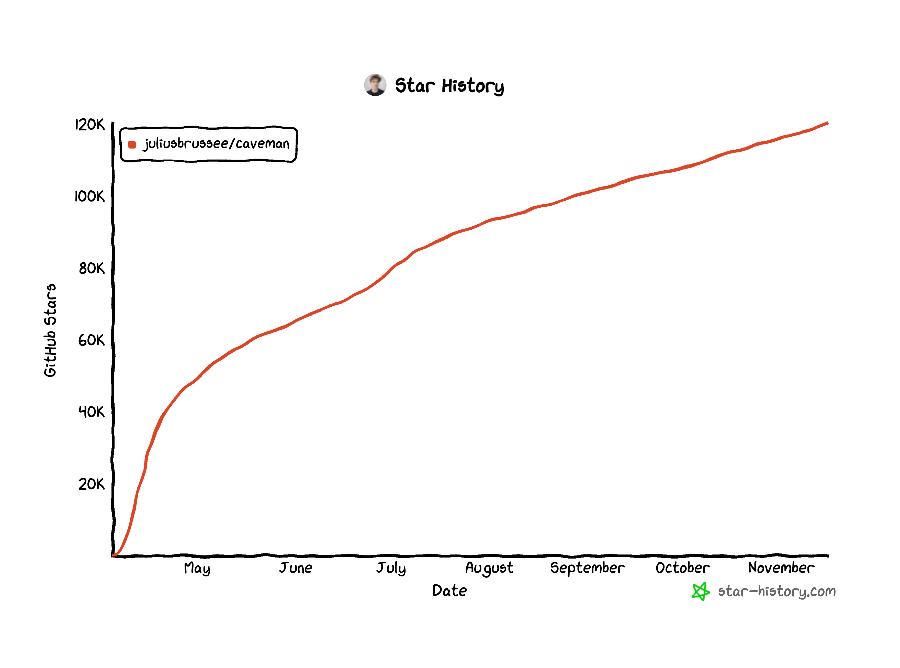

<div align="center">


# why many token when few do trick

**Caveman make your AI agent say less and read less. Code stay exact. Brain still big.**

<a href="https://github.com/JuliusBrussee/caveman/stargazers"></a>
<a href="https://www.npmjs.com/package/@caveman-ai/cli"></a>
<a href="./INSTALL.md"></a>
<a href="#license"></a>

<table>
<tr>
<td align="center" width="25%"><h3>33.2% fewer</h3>input tokens, whole sessions<br><sub><a href="#read-less-332-fewer-input-tokens">6 synthetic large-tool-output tasks, 18 pairs</a>, Aug 2026 engine, 18 of 18 answers right</sub></td>
<td align="center" width="25%"><h3>0.46×</h3>the cost of Opus at xhigh, with Auto<br><sub><a href="#auto-046x-the-cost-of-opus-at-xhigh-interim">85 coding tasks</a>, interim, score gap ±7 points, unresolved</sub></td>
<td align="center" width="25%"><h3>397 → 76</h3>tokens for one test run<br><sub><a href="#blocks-code-mode-script-written-once">Blocks</a> vs <code>| tail -20</code></sub></td>
<td align="center" width="25%"><h3>1.4 to 2.4× cheaper</h3>with caveman-style output<br><sub><a href="https://arxiv.org/abs/2606.24083">Adobe Research</a>, eight models</sub></td>
</tr>
</table>

Cited by **[Adobe Research](https://arxiv.org/abs/2606.24083)** · A/B tested by **[JetBrains](https://blog.jetbrains.com/ai/2026/07/speak-to-ai-agents-like-cavemen-tosave-tokens/)** · Remade for Elasticsearch on **[Elasticsearch Labs](https://www.elastic.co/search-labs/blog/elastic-caveman-ai-token-reduction)**<br>
**#1** on [Hacker News](https://news.ycombinator.com/item?id=47647455) · **#1** on GitHub Trending · *"No way this actually works."* [ThePrimeagen](https://www.youtube.com/watch?v=L29q2LRiMRc)

**[Install](#install) · [Just the voice](#say-less-the-caveman-voice) · [The numbers](#proof) · [Commands](#commands)**

</div>

---

<table>
<tr>
<th width="50%">Normal agent · 63 tokens</th>
<th width="50%"> Caveman agent · 20 tokens</th>
</tr>
<tr>
<td valign="top">

> The reason your React component is re-rendering is likely because you're creating a new object reference on each render cycle. When you pass an inline object as a prop, React's shallow comparison sees it as a different object every time, which triggers a re-render. I'd recommend using useMemo to memoize the object.

</td>
<td valign="top">

> New object ref each render, so React re-renders. Wrap the prop in `useMemo`.

</td>
</tr>
</table>

**Same fix. 63 token become 20.**

Pick your club:

| Skill | Same answer | Tokens |
|---|---|---:|
| `/caveman` | New object ref each render, so React re-renders. Wrap the prop in `useMemo`. | 20 |
| `/ultracave` | Inline object prop, new ref, re-render. `useMemo`. | 14 |
| `/megacave` | 新參照致重繪。`useMemo`。 | 13 |

<sub>Token counts: tiktoken o200k. The example assumes a memoized child and stable `useMemo` dependencies.</sub>

## Install

```bash
npx @caveman-ai/cli@latest
```

One command. Mac, Linux, Windows. Caveman find your agents and your logins, show what it will change. Press Enter. Done. Needs Node.js 22.13+.

Open a fresh terminal and run `claude` like always. It stays caveman'd from now on, and so do Codex, Gemini CLI, OpenCode and [30+ more](./INSTALL.md). Everything runs on your machine, with the keys and logins you already have.

<sub>Had caveman before 4.0? Say <code>@latest</code>, or the old copy on your machine wins. Already set up? <code>caveman setup</code> opens the screen again. Only want shorter answers? <a href="#say-less-the-caveman-voice">Get just the skill</a>.</sub>

## Six rocks, one install

The skill was the first rock. 4.0 add five more. All on after install, each with its own switch.

| Rock | What it does | Measured |
|---|---|---|
| **[Say less](#say-less-the-caveman-voice)** | Agent answers short. Code stays exact | 3% shorter than "Answer concisely." (ultracave 35%), n=10 |
| **[Read less](#read-less-332-fewer-input-tokens)** | Logs, JSON, CSV, test output shrink before the model reads them | **33.2%** fewer input tokens per session (6 synthetic large-tool-output tasks, 18 pairs, Aug 2026 engine) |
| **[Auto](#auto-046x-the-cost-of-opus-at-xhigh-interim)** · new | Picks the model and the effort for each ask | 0.46× the cost of Opus at xhigh in an interim run (85 tasks); quality gap unresolved |
| **[Blocks](#blocks-code-mode-script-written-once)** · new | Code mode: agent keeps the scripts it writes and runs them again | **397 → 76** tokens for one test run |
| **[Waste fixes](#smaller-rocks)** | Finds where your tokens go and fixes it. New: keeps the prompt cache warm while you pause | Not measured yet |
| **[Browse](#smaller-rocks)** | Web pages come back compressed | 14.9% smaller full page than Playwright; 121 vs 15,704 tokens with a query, on one 200-row table |

`caveman status` shows what is on. `caveman off browse` turns one off. Only Auto needs an account, and it is free. [4.0.0 release notes](https://github.com/JuliusBrussee/caveman/releases/tag/v4.0.0)

## Proof

Outside labs first. Ours come with each rock below. Nothing rounded up. Red rows stay red.

| Who | Setup | Result |
|---|---|---|
| **[Adobe Research](https://arxiv.org/abs/2606.24083)**, CAVEWOMAN paper (cites this repo) | Caveman-style output, eight models, five datasets | **Cost cut 1.4 to 2.4× per model, up to 3×** |
| **[Elastic](https://www.elastic.co/search-labs/blog/elastic-caveman-ai-token-reduction)**, Elasticsearch Labs | Caveman mode remade for Elasticsearch, eight live MCP scenarios | **63.6% fewer response tokens.** *"Zero information loss."* |
| **[JetBrains](https://blog.jetbrains.com/ai/2026/07/speak-to-ai-agents-like-cavemen-tosave-tokens/)** | 86 real coding tasks, paired A/B | **No measurable quality loss** (p = 0.82). 8.5% fewer output tokens |

Two findings shaped caveman. Adobe also cavemanned the *user's* prompt, and answers got worse, so caveman never touches yours. JetBrains found that code and tool calls make up most of an agent session, and the voice leaves those alone. So caveman grew rocks that shrink what the agent *reads* and pick what it *runs on*.

## Say less: the caveman voice

Answer first. Padding out. Every reply has the same shape.

| Rule | What it means |
|---|---|
| **Answer first** | `[thing] [action] [reason]. [next step].` No greeting, no "let me", no recap |
| **One idea per sentence** | Built on [ASD-STE100](https://www.asd-ste100.org/), the controlled English of aircraft maintenance manuals: 20 words max, active voice, one term per thing |
| **Meaning never dropped** | Articles can go. *not*, *never*, *no*, *only* never go. Numbers and units stay exact |
| **Payload verbatim** | Code, commands, paths, and error messages untouched, character for character |
| **No theater** | No "me think". No chatter between tool calls. If caveman phrasing isn't shorter, plain wins |
| **Knows when to stop** | Security warnings and irreversible actions get full sentences. So does anyone who asks for clarification |
| **Your prompts stay yours** | Never rewritten. [Research say that backfire](#proof) |

An example run, n=10, not a claim. Ten developer questions on Opus 5.5, 3.1.0 voice rules:

| Instruction | Output tokens |
|---|---:|
| None | 6,983 |
| `Answer concisely.` | 4,334 |
| `/caveman` | 4,119 |
| `/ultracave` | **2,693** |

"Answer concisely." is the real baseline, because new models already know how. On top of it, `/caveman` cuts 3% more output at the median and `/ultracave` 35% more. Measured on the 3.1.0 rules, not re-run since. The rules themselves cost about 1,160 input tokens, so a short session can come out more expensive, and on a per-request plan like GitHub Copilot shorter answers save nothing. [Harness](./evals/README.md) · [Every case where caveman loses](./docs/HONEST-NUMBERS.md)

<!-- BENCHMARK-TABLE-START -->
<!-- BENCHMARK-TABLE-END -->

**Only want this rock?** The skill alone, no proxy:

```bash
npx skills add JuliusBrussee/caveman -g
```

<a href="https://skills.sh/JuliusBrussee/caveman"></a>

Type `/caveman` (`$caveman` in Codex) if it doesn't start on its own. Say `stop caveman` to go back.

<details>
<summary><strong>Other ways in</strong>: Claude app and phone, Claude Code plugin, Gemini, every agent at once, Windows, uninstall</summary>

<br>

Claude on the web, the phone app, or Cowork? No terminal. Add caveman to your Claude account once, in Customize > Plugins: [steps](./INSTALL.md#claude-apps-claudeai-desktop-mobile-cowork). Not tested end to end yet.

```bash
# Claude Code plugin, auto-starts every interactive session, subagents too
claude plugin marketplace add JuliusBrussee/caveman && claude plugin install caveman@caveman

# Gemini CLI
gemini extensions install https://github.com/JuliusBrussee/caveman

# Every agent on your machine at once, plus the Claude Code statusline badge (skills need Node.js 18+, the runtime 22.13+)
curl -fsSL https://raw.githubusercontent.com/JuliusBrussee/caveman/v4.2.0/install.sh | bash
```

Already inside Claude Code? Same rock, slash form. Type these where you talk to Claude:

```text
/plugin marketplace add JuliusBrussee/caveman
/plugin install caveman@caveman
```

Windows, PowerShell 5.1+:

```powershell
irm https://raw.githubusercontent.com/JuliusBrussee/caveman/v4.2.0/install.ps1 | iex
```

npm 12 blocks Git installs by default. The pinned scripts above handle it. To install straight from GitHub on npm 12, use:
`npx --allow-git=root -y github:JuliusBrussee/caveman#v4.2.0`

Changed your mind: `npx -y github:JuliusBrussee/caveman -- --uninstall` (on npm 12+, add `--allow-git=root`). Only grabbed the skill? `npx skills remove JuliusBrussee/caveman -g` takes it back out.

Install broke? Open your agent in this repo and say *"Read INSTALL.md, install caveman for me."* Agent fix own brain.

</details>

## Read less: 33.2% fewer input tokens

The voice shrinks what the agent says. This rock shrinks what it reads. A 28,041-token CSV reached the model as 314 tokens, the original stayed on disk for the agent to pull back, and across six synthetic tasks with large tool outputs the answers stayed right: 18 of 18.

| File type | The file, through caveman | File saved | Whole Claude Code session, 3 runs | Session saved |
|---|---:|---:|---:|---:|
| CSV | 28,041 → **314** | **98.9%** | 165,823 → 74,484 | **55.1%** |
| Logs | 22,810 → **348** | **98.5%** | 148,807 → 74,068 | **50.2%** |
| YAML | 20,447 → **178** | **99.1%** | 132,124 → 71,027 | **46.2%** |
| Test output | 18,806 → **203** | **98.9%** | 150,377 → 108,514 | **27.8%** |
| JSON | 18,837 → **281** | **98.5%** | 147,975 → 108,939 | **26.4%** |
| HTML | 21,670 → 21,670 | none yet | 140,687 → 154,641 | 9.9% worse |
| **All six** | 130,611 → 22,994 | 82.4% | **885,793 → 591,673** | **33.2%** |

*The file* is each test file through the compressor alone. *The session* is the whole Claude Code run, which also carries the system prompt and tools, so it moves less: 18 paired runs on the August 2026 engine. Honest part: each test file hides one record in 61 to 72 KB of noise, so yours will vary, and HTML had no compressor in that run, which made the session 9.9% bigger. Headroom on the same suite: 15 of 18 right, 6.7% fewer tokens, interval crosses zero, harness not public. [Method](./docs/WRAP-BENCHMARK.md#per-file-compression)

## Auto: 0.46x the cost of Opus at xhigh (interim)

Pick Auto in your agent's model menu and caveman chooses the model and effort for each ask. Hard ask, big brain. Easy ask, save rocks.

| Setup | Tasks solved | Cost per try | Median time |
|---|---:|---:|---:|
| Opus 5.5, xhigh effort, every ask | 44.3% | $7.83 | 35.2 min |
| **Auto**, Claude models only | **43.7%** | **$3.59** | **15.9 min** |
| **Auto**, plus OpenAI and open models | 42.9% | $3.47 | 16.7 min |

Claude-only Auto cost 0.46× what Opus 5.5 at xhigh cost per attempt, at list prices, and finished in under half the time. That is 85 real coding tasks from SWE-Interact and SWE-Together, one try each.

Honest part: the run stopped at 85 of 169 planned tasks. The two scores shown differ by 0.6 points; paired task by task, the gap is −0.5 points with a 95% interval of −6.8 to +5.7, too wide to call either way. Most of the saving comes from Auto turning Opus effort down from xhigh to medium or high, so an agent already on Opus at medium should expect much less. That case is not measured yet. [Full table and limits](./docs/AUTO-BENCHMARK.md)

```bash
caveman login                  # free account. Auto shows up in the model picker
caveman providers add openai   # optional: give Auto more models, on your own key
```

Works in Claude Code, OpenCode, and Codex on a ChatGPT login, with API keys, Claude Pro/Max, or ChatGPT. Any other model you pick runs as picked. Not signed in: no Auto, nothing sent. [What Auto sends](#privacy)

## Blocks: code mode, script written once

**skills.sh for code mode.** Code mode is the agent writing a script instead of making tool call after tool call ([Cloudflare](https://blog.cloudflare.com/code-mode/), [Anthropic](https://www.anthropic.com/engineering/code-execution-with-mcp)). Problem: agent write same script every session, throw it away, write it again. Blocks keep it in `.blocks/`, list it in the agent's instructions, and the [CI check](https://github.com/caveman-ai/blocks/blob/main/docs/CI.md) reruns its example on every pull request.

| Input | Raw | What agents type now | Block |
|---|---:|---:|---:|
| `go test -v ./...`, 326 tests | 10,561 | 397 · `\| tail -20` | **76** · `test-summary` |
| 1.4 MB JSON file | 251,893 | 236 · their own heredoc | **227** · `json-peek` |
| 366-line Go file | 3,111 | **250** · `grep -n` | 489 · `grep-defs` |

Tokens the agent reads back. `grep-defs` loses to a bare grep; row stays. On a bigger 14.3 MB JSON file the heredoc wins too, because it prints one key and quits ([that run](https://github.com/caveman-ai/blocks#blocks-against-what-agents-type-now)). The retyping is real: in one week, agents on one machine wrote the same script [394 times](https://github.com/caveman-ai/blocks#one-script-written-394-times-in-a-week), and [Purdue](https://arxiv.org/abs/2609.30725) measured the habit at up to 9.57% of task cost.

Comes with caveman. Eight blocks ready: `json-peek` · `jsonl-stats` · `test-summary` · `first-error` · `wait-for` · `grep-defs` · `http-json` · `replace-in-file`. When the agent starts typing a script a block already covers, it gets one line: use the block. Never denies or rewrites a command.

```bash
caveman-blocks scan    # what your agents retyped this month. Script text never leaves your machine
caveman-blocks init    # rules and block index into this repo's AGENTS.md
```

Pre-release (v0.1.0-rc.5). Python only, no sandbox yet. Own repo, own stars: **[caveman-ai/blocks](https://github.com/caveman-ai/blocks)**

## Smaller rocks

| Rock | What it does | Measured |
|---|---|---|
| `caveman learn` | Ranks where your tokens go, from agent history already on disk. `caveman learn implement` applies fixes one diff at a time, only on your yes | Not yet |
| Warm cache · new | Step away and the provider forgets your session, so the next ask pays full price. Caveman keeps Anthropic's prompt cache warm while you pause, only when your own history says you come back in time. Every warm is listed in `caveman stats` | Not yet |
| `caveman browse <url>` | A compressed web page for the agent | **121 tokens instead of 15,704** for a Playwright snapshot of a 200-row table. Tiny forms lose 2.3×. [Bench](./browse/BENCHMARK.md) |
| `/caveman-compress <file>` | Shrinks memory files like `CLAUDE.md`, keeps a backup | **4,138 tokens instead of 6,198** across five files, 22.8% to 49.1% each, every heading, code block and path intact. [Bench](./skills/caveman-compress/README.md#benchmarks) |
| Middleware | Same shrinking inside the Vercel AI SDK, LangChain, OpenAI, or Anthropic call you already make. [TypeScript](./packages/middleware/typescript/README.md) · [Python](./packages/middleware/python/README.md) · [Every framework](https://docs.caveman.so/caveman/middleware) · [One container for the team](docs/technical/deploy.md) | Not yet |

<p align="center">
  
</p>

## Commands

In your terminal:

```bash
caveman claude                # start an agent on caveman: codex · gemini · opencode · aider · kilo · qwen · hermes · openclaw · pi
caveman status                # what is on, which agents it reaches, one next step
caveman on browse             # switch one rock on or off: output · input · waste-fixes · routing · scripts · browse
caveman login                 # free account, turns on Auto
caveman learn                 # where your tokens go
caveman trial -- claude       # A/B a real session on your own work
caveman shrink -- pnpm test   # compress noisy command output
caveman convert --dry-run     # pixel mode: skills the model reads as images
caveman stats                 # your token history
caveman doctor                # one problem per line, with its fix
```

In your agent:

| Command | What it does |
|---|---|
| `/caveman` · `/ultracave` · `/megacave` | The voice, the grunt, the 文言文. `/caveman status` shows the mode, `/caveman off` stops it |
| `/caveman-commit` | One-line Conventional Commit |
| `/caveman-review` | One finding per line: `L42: 🔴 null deref. Guard it.` |
| `/caveman-compress <file>` | Shrinks memory files and backs up the original |
| `/caveman-stats` | Real token usage for this Claude Code session |
| `/caveman-help` | Every mode and command on one screen |
| `cavecrew` | Subagents that find, edit, and review code, then report back in caveman |
| `investigate-first` · `lean-build` · `surgical-patch` · `safe-refactor` · `migration` · `verify-and-stop` | Work patterns that write less code. Your agent picks them up when a task fits |
| `caveman-setup` · `caveman-discover` · `caveman-learn` · `caveman-manage` · `caveman-optimize` · `caveman-explore` · `caveman-evidence-review` | Drive the proxy from inside your agent |

## New: Caveman Code. Free.

**21% less than Codex per solved task on Terminal-Bench 4.** Same model on both sides.

<table>
<tr>
<td align="center"><h3>21% cheaper</h3>than Codex<br><sub>Terminal-Bench 4, per solved task, GPT-6.1 Sol: $1.21 vs $1.52, 90 of 192 runs solved both</sub></td>
<td align="center"><h3>Level</h3>with Claude Code within noise<br><sub>Terminal-Bench 4, Opus 5.5: 97 of 180 runs solved vs 83 of 177; $5.19 vs $6.04 per solved task, 95% interval 0.70x to 1.02x</sub></td>
</tr>
</table>

Every coding agent in one window, free on the subscriptions and keys you already have. Our own runs, November 2026, list prices, same model on both sides. The Mac app ships the same harness with three benchmark-only settings turned off.

[Download for Mac](https://caveman.so/download) · [How we measured](https://caveman.so/code#benchmarks)

## Caveman Cloud

**Everything above is for the coding agent you use. Caveman Cloud is for the agents you build.**

You ship an agent and every run costs money. Cloud hosts it, traces what each run did and what it cost, and tests a change against recorded work before you trust it.

| Cloud does | What you get |
|---|---|
| **Observability** | Trace a run back to what it did and what it cost. Connect the logs or OpenTelemetry you already have |
| **Evals** | Grades how good the answers are, on your own tasks, from your real traffic |
| **Deploy** | `cvm deploy ./my-agent --budget 2` deploys an agent with a spend cap. Firecracker sandboxes for the code it runs |
| **Proof** | Every number says if it is measured, inferred, or verified. A saving counts only after real traffic shows it |

<p align="center">
<a href="https://app.caveman.so/signup"><b>Sign up free</b></a> &nbsp;·&nbsp; <a href="https://github.com/caveman-ai/cloud-sdk">CLI and SDKs</a> &nbsp;·&nbsp; <a href="https://docs.caveman.so">Docs</a>
</p>

## In the wild

<a href="https://www.youtube.com/watch?v=L29q2LRiMRc"></a>

**ThePrimeagen**: *"No way this actually works."* [Watch](https://www.youtube.com/watch?v=L29q2LRiMRc)

**Adobe Research**: [CAVEWOMAN](https://arxiv.org/abs/2606.24083), arXiv, June 2026

**JetBrains**: *"It is fun, and it costs you nothing measurable in quality."* [Read](https://blog.jetbrains.com/ai/2026/07/speak-to-ai-agents-like-cavemen-tosave-tokens/)

**Elastic**: [elastic-caveman](https://www.elastic.co/search-labs/blog/elastic-caveman-ai-token-reduction) on Elasticsearch Labs, April 2026

**Hacker News**: [#1, 904 points](https://news.ycombinator.com/item?id=47647455)

**GitHub Trending** #1 across all repos in July 2026 · **[Trendshift](https://trendshift.io/repositories/25391)** #1 repo of the day, April 2026 · **[Product Hunt](https://www.producthunt.com/products/caveman)** #8 of the day

Started as a joke in April 2026. Now past 100,000 stars. Joke got serious. Voice did not.

<br clear="right">

[](https://star-history.com/#JuliusBrussee/caveman&Date)

## Privacy

The local voice skill sends nothing itself. `/caveman-compress` sends the file you're compressing to your configured model provider.

CLI telemetry is on by default. It includes commands run, token counts, counts for Blocks, a random install ID, and your OS and IP address. Your prompts, scripts, code and file paths stay out of telemetry. Disable it for both the CLI and Blocks with `caveman telemetry off` or `DO_NOT_TRACK=1`.

When you're signed in and pick Auto, each routing request sends your last two asks, with whatever your agent attached to them (such as `CLAUDE.md`, memory or @-mentioned files), plus the end of the agent's last reply. It also sends tool names, effort, some agent headers and the previous request's token counts. On the Free plan Caveman may keep this data to improve routing. Turn it off with `caveman off routing`.

Requests using your own provider keys go directly to the provider you chose. A request routed to a Cloud model passes through Caveman Cloud in full, including the system prompt and any tool results or code. It uses the stored key for your Cloud project and bills that project. Turn off that provider with `caveman providers cloud off`.

The full list, and how to delete sent telemetry: [SECURITY.md](./SECURITY.md).

## License

[Apache-2.0](./LICENSE), whole repo. Read it, fork it, ship it, host it. Free like mammoth on open plain. Older releases and third-party notices: [LICENSING.md](./LICENSING.md). "Caveman" and the rock logo are trademarks of Julius Brussee.

## Cite

```bibtex
@software{brussee2026caveman,
  author = {Brussee, Julius},
  title  = {Caveman: why many token when few do trick},
  year   = {2026},
  url    = {https://github.com/JuliusBrussee/caveman}
}
```

---

<div align="center">

**Caveman save you token. Star cost zero. Fair trade.**

<sub>
<a href="./docs/README.md">Docs</a> ·
<a href="./INSTALL.md">Install matrix</a> ·
<a href="./docs/HONEST-NUMBERS.md">Honest numbers</a> ·
<a href="./CONTRIBUTING.md">Contributing</a> ·
<a href="https://app.caveman.so/signup">Caveman Cloud</a> ·
<a href="https://github.com/JuliusBrussee/caveman/issues">Issues</a>
</sub>

</div>
