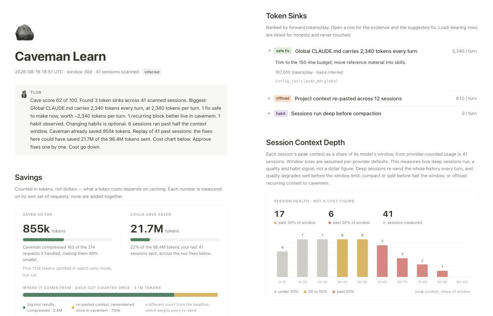
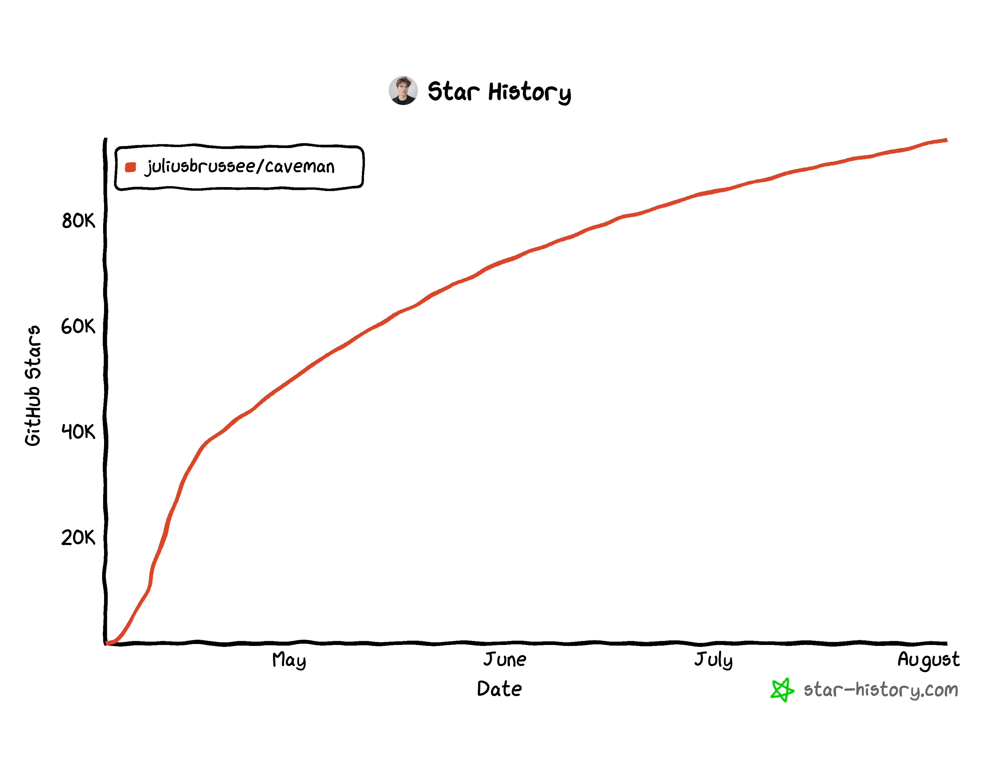

<div align="center">


# why many token when few do trick

**Caveman make your AI agent say less and read less. Code stay exact. Brain still big.**

<a href="https://github.com/JuliusBrussee/caveman/stargazers"></a>
<a href="https://www.npmjs.com/package/@caveman-ai/cli"></a>
<a href="./INSTALL.md"></a>
<a href="#license"></a>

<!-- gitreels:start -->
<p align="center">
  <a href="https://gitreels.com/JuliusBrussee/caveman"></a>
  <br>
  <a href="https://gitreels.com"></a>
</p>
<!-- gitreels:end -->

<table>
<tr>
<td align="center" width="25%"><h3>33.2% fewer</h3>input tokens, whole sessions<br><sub><a href="#read-less-332-fewer-input-tokens">54 Claude Code runs</a>, 18 of 18 answers right</sub></td>
<td align="center" width="25%"><h3>54% cheaper</h3>with Auto, same score<br><sub><a href="#auto-54-cheaper-same-score">85 coding tasks</a> vs Opus 5.5 at xhigh, interim</sub></td>
<td align="center" width="25%"><h3>397 → 76</h3>tokens for one test run<br><sub><a href="#blocks-code-mode-script-written-once">Blocks</a> vs <code>| tail -20</code></sub></td>
<td align="center" width="25%"><h3>1.4 to 2.4× cheaper</h3>with caveman-style output<br><sub><a href="https://arxiv.org/abs/2606.24083">Adobe Research</a>, eight models</sub></td>
</tr>
</table>

Cited by **[Adobe Research](https://arxiv.org/abs/2606.24083)** · A/B tested by **[JetBrains](https://blog.jetbrains.com/ai/2026/07/speak-to-ai-agents-like-cavemen-tosave-tokens/)** · Remade for Elasticsearch on **[Elasticsearch Labs](https://www.elastic.co/search-labs/blog/elastic-caveman-ai-token-reduction)**<br>
**#1** on [Hacker News](https://news.ycombinator.com/item?id=47647455) · **#1** on GitHub Trending · *"No way this actually works."* [ThePrimeagen](https://www.youtube.com/watch?v=L29q2LRiMRc)

**[Install](#install) · [Six rocks](#six-rocks-one-install) · [Proof](#proof) · [Say less](#say-less-the-caveman-voice) · [Read less](#read-less-332-fewer-input-tokens) · [Auto](#auto-54-cheaper-same-score) · [Blocks](#blocks-code-mode-script-written-once) · [Commands](#commands) · [Caveman Cloud](#caveman-cloud)**

</div>

---

<table>
<tr>
<th width="50%">Normal agent · 63 tokens</th>
<th width="50%"> Caveman agent · 20 tokens</th>
</tr>
<tr>
<td valign="top">

> The reason your React component is re-rendering is likely because you're creating a new object reference on each render cycle. When you pass an inline object as a prop, React's shallow comparison sees it as a different object every time, which triggers a re-render. I'd recommend using useMemo to memoize the object.

</td>
<td valign="top">

> New object ref each render, so React re-renders. Wrap the prop in `useMemo`.

</td>
</tr>
</table>

**Same fix. 63 token become 20. Brain still big.**

Pick your club:

| Skill | Same answer | Tokens |
|---|---|---:|
| `/caveman` | New object ref each render, so React re-renders. Wrap the prop in `useMemo`. | 20 |
| `/ultracave` | Inline object prop, new ref, re-render. `useMemo`. | 14 |
| `/megacave` | 新參照致重繪。`useMemo`。 | **13** |

<sub>Token counts: tiktoken o200k.</sub>

## Install

```bash
npx @caveman-ai/cli@latest
```

One command. Mac, Linux, Windows. Caveman find your agents and your logins, show what it change. Press Enter. Done. Needs Node.js 22.13+.

After that, plain `claude` stays caveman'd. So do Codex, Gemini CLI, OpenCode, and [30+ more](./INSTALL.md). It runs on your machine, with your keys and your Claude Pro/Max login. One rock. That it.

<sub>Had caveman before 4.0? Say <code>@latest</code>, or the old copy on your machine wins. Already set up? <code>caveman setup</code> opens the screen again. Only want shorter answers? <a href="#say-less-the-caveman-voice">Get just the skill</a>.</sub>

## Six rocks, one install

New in 4.0: caveman is six parts. All on after install. Each has its own switch.

| Rock | What it does | Measured |
|---|---|---|
| **[Say less](#say-less-the-caveman-voice)** | Agent answers short. Code stays exact | 63 → 20 tokens, same fix |
| **[Read less](#read-less-332-fewer-input-tokens)** | Logs, JSON, CSV, test output shrink before the model reads them | **33.2%** fewer input tokens per session |
| **[Auto](#auto-54-cheaper-same-score)** · new | Picks the model and the effort for each ask | **54%** cheaper than Opus at xhigh, same score |
| **[Blocks](#blocks-code-mode-script-written-once)** · new | Code mode: agent keeps the scripts it writes and runs them again | **397 → 76** tokens for one test run |
| **[Waste fixes](#smaller-rocks)** | Finds where your tokens go and fixes it. New: keeps the prompt cache warm while you pause | Not measured yet |
| **[Browse](#smaller-rocks)** | Web pages come back compressed | **129.8×** smaller page |

`caveman status` shows what is on. `caveman off browse` turns one off. Only Auto needs an account, and it is free. [4.0.0 release notes](https://github.com/JuliusBrussee/caveman/releases/tag/v4.0.0)

## Proof

Outside labs first. Ours come with each rock below. Nothing rounded up. Red rows stay red.

| Who | Setup | Result |
|---|---|---|
| **[Adobe Research](https://arxiv.org/abs/2606.24083)**, CAVEWOMAN paper (cites this repo) | Caveman-style output, eight models, five datasets | **Cost cut 1.4 to 2.4× per model, up to 3×** |
| **[Elastic](https://www.elastic.co/search-labs/blog/elastic-caveman-ai-token-reduction)**, Elasticsearch Labs | Caveman mode remade for Elasticsearch, eight live MCP scenarios | **63.6% fewer response tokens.** *"Zero information loss."* |
| **[JetBrains](https://blog.jetbrains.com/ai/2026/07/speak-to-ai-agents-like-cavemen-tosave-tokens/)** | 86 real coding tasks, paired A/B | **No measurable quality loss** (p = 0.82). 8.5% fewer output tokens |

Two findings shaped caveman. Adobe: cavemanning *your* prompt makes answers worse, so caveman never touches your prompt. JetBrains: agent sessions are mostly code and tool calls, which the voice leaves alone. So caveman grew rocks that shrink what the agent *reads* and what it *runs on*.

## Say less: the caveman voice

**A voice, not broken grammar. Every reply follows the same structure.**

| Rule | What it means |
|---|---|
| **Answer first** | `[thing] [action] [reason]. [next step].` No greeting, no "let me", no recap |
| **One idea per sentence** | Built on [ASD-STE100](https://www.asd-ste100.org/), the controlled English of aircraft maintenance manuals: 20 words max, active voice, one term per thing |
| **Meaning never dropped** | Articles can go. *not*, *never*, *no*, *only* never go. Numbers and units stay exact |
| **Payload verbatim** | Code, commands, paths, and error messages untouched, character for character |
| **No theater** | No "me think". No chatter between tool calls. If caveman phrasing isn't shorter, plain wins |
| **Knows when to stop** | Security warnings, irreversible actions, and confused users get full sentences. Then grunt resumes |
| **Your prompts stay yours** | Never rewritten. [Research say that backfire](#proof) |

Ten dev questions on claude-opus-5-5:

| Instruction | Output tokens |
|---|---:|
| None | 6,983 |
| `Answer concisely.` | 4,334 |
| `/caveman` | 4,119 |
| `/ultracave` | **2,693** |

"Be concise" is the real baseline; new models already know it. On top of it, `/caveman` cuts 3% more at the median and `/ultracave` 35% more. Measured on the 3.1.0 rules, not yet re-run. The rules cost about 1,160 tokens of input, and if you pay per request (GitHub Copilot), shorter answers save nothing. [Harness](./evals/README.md) · [Every case where caveman loses](./docs/HONEST-NUMBERS.md)

<!-- BENCHMARK-TABLE-START -->
<!-- BENCHMARK-TABLE-END -->

**Only want this rock?** The skill alone, no proxy:

```bash
npx skills add JuliusBrussee/caveman -g
```

<a href="https://skills.sh/JuliusBrussee/caveman"></a>

Type `/caveman` (`$caveman` in Codex) if it doesn't start on its own. Say `stop caveman` to go back.

<details>
<summary><strong>Other ways in</strong>: Claude app and phone, Claude Code plugin, Gemini, every agent at once, Windows, uninstall</summary>

<br>

Claude on the web, the phone app, or Cowork? No terminal. Add caveman to your Claude account once, in Customize > Plugins: [steps](./INSTALL.md#claude-apps-claudeai-desktop-mobile-cowork). Not tested end to end yet.

```bash
# Claude Code plugin, auto-starts every interactive session, subagents too
claude plugin marketplace add JuliusBrussee/caveman && claude plugin install caveman@caveman

# Gemini CLI
gemini extensions install https://github.com/JuliusBrussee/caveman

# Every agent on your machine at once, plus the Claude Code statusline badge (Node.js 22.13+)
curl -fsSL https://raw.githubusercontent.com/JuliusBrussee/caveman/v4.0.1/install.sh | bash
```

Already inside Claude Code? Same rock, slash form. Type these where you talk to Claude:

```text
/plugin marketplace add JuliusBrussee/caveman
/plugin install caveman@caveman
```

Windows, PowerShell 5.1+:

```powershell
irm https://raw.githubusercontent.com/JuliusBrussee/caveman/v4.0.1/install.ps1 | iex
```

On npm 12 or newer, new npm block git install. One-liners above handle it themselves from v3.2.0 on. Old one-liner pinned to v3.1.0 or older still fail there: use one above, or this:
`npx --allow-git=root -y github:JuliusBrussee/caveman#v4.0.1`

Changed your mind: `npx -y github:JuliusBrussee/caveman -- --uninstall` (on npm 12+, add `--allow-git=root` too)

Only grabbed the skill? `npx skills remove JuliusBrussee/caveman -g` take it back out.

Install broke? Open your agent in this repo and say *"Read CLAUDE.md and INSTALL.md, install caveman for me."* Agent fix own brain.

</details>

## Read less: 33.2% fewer input tokens

**The voice shrinks what the agent says. This shrinks what it reads. Same answers: 18 of 18 right.**

| File type | The file, through caveman | File saved | Whole Claude Code session, 3 runs | Session saved |
|---|---:|---:|---:|---:|
| CSV | 28,041 → **314** | **98.9%** | 165,823 → 74,484 | **55.1%** |
| Logs | 22,810 → **348** | **98.5%** | 148,807 → 74,068 | **50.2%** |
| YAML | 20,447 → **178** | **99.1%** | 132,124 → 71,027 | **46.2%** |
| Test output | 18,806 → **203** | **98.9%** | 150,377 → 108,514 | **27.8%** |
| JSON | 18,837 → **281** | **98.5%** | 147,975 → 108,939 | **26.4%** |
| HTML | 21,670 → 21,670 | none yet | 140,687 → 154,641 | 9.9% worse |
| **All six** | 130,611 → 22,994 | 82.4% | **885,793 → 591,673** | **33.2%** |

*The file* is each test file through today's compressor alone. *The session* is the whole agent run, which also carries the system prompt and tools, so it moves less. Honest part: the session run is from August 2026 on an older engine, HTML has no compressor yet so it lost, and each test file hides one record in 61 to 72 KB of noise. Yours will vary. Headroom on the same suite: 15 of 18 right, 6.7% fewer tokens. [Method](./docs/WRAP-BENCHMARK.md#per-file-compression)

Every original stays on your disk. The agent can pull it back any time.

## Auto: 54% cheaper, same score

**New model in your agent's picker. Pick Auto and caveman chooses the model and the effort for each ask. Hard ask, big brain. Easy ask, save rocks.**

| Setup | Tasks solved | Cost per try | Median time |
|---|---:|---:|---:|
| Opus 5.5, xhigh effort, every ask | 44.3% | $7.83 | 35.2 min |
| **Auto**, Claude models only | **43.7%** | **$3.59** | **15.9 min** |
| **Auto**, plus OpenAI and open models | 42.9% | $3.47 | 16.7 min |

Auto costs 0.46× what Opus 5.5 at xhigh costs. That is 54% saved, in under half the time. 85 real coding tasks from SWE-Interact and SWE-Together, one try each. Honest part: the run is half done, the 0.5-point score gap is too small to tell apart at this size (±7), and most of the saving is Auto lowering effort on easy asks. Already on Opus at medium? Expect less; not measured yet. [Full table and limits](./docs/AUTO-BENCHMARK.md)

```bash
caveman login                  # free account. Auto shows up in the model picker
caveman providers add openai   # optional: give Auto more models, on your own key
```

Works in Claude Code, OpenCode, and Codex on a ChatGPT login, with API keys, Claude Pro/Max, or ChatGPT. Any other model you pick runs as picked. Not signed in: no Auto, nothing sent. [What Auto sends](#privacy)

## Blocks: code mode, script written once

**skills.sh for code mode.** Code mode is the agent writing a script instead of making tool call after tool call ([Cloudflare](https://blog.cloudflare.com/code-mode/), [Anthropic](https://www.anthropic.com/engineering/code-execution-with-mcp)). Problem: agent write same script every session, throw it away, write it again. Blocks keep it in your repo, check it every pull request, hand it back.

| Input | Raw | What agents type now | Block |
|---|---:|---:|---:|
| `go test -v ./...`, 326 tests | 10,561 | 397 · `\| tail -20` | **76** · `test-summary` |
| 1.4 MB JSON file | 251,893 | 236 · their own heredoc | **227** · `json-peek` |
| 366-line Go file | 3,111 | **250** · `grep -n` | 489 · `grep-defs` |

Tokens the agent reads back. In one week, agents on one machine wrote the same script [394 times](https://github.com/caveman-ai/blocks#one-script-written-394-times-in-a-week). [Purdue](https://arxiv.org/abs/2609.30725) measured the habit at up to 9.57% of task cost. `grep-defs` loses to a bare grep; row stays. [Method](https://github.com/caveman-ai/blocks#blocks-against-what-agents-type-now)

Comes with caveman. Eight blocks ready: `json-peek` · `jsonl-stats` · `test-summary` · `first-error` · `wait-for` · `grep-defs` · `http-json` · `replace-in-file`. When the agent starts typing a script a block already covers, it gets one line: use the block. Never denies or rewrites a command.

```bash
caveman-blocks scan    # what your agents retyped this month. Script text never leaves your machine
caveman-blocks init    # rules and block index into this repo's AGENTS.md
```

Pre-release (v0.1.0-rc.5). Python only, no sandbox yet. Own repo, own stars: **[caveman-ai/blocks](https://github.com/caveman-ai/blocks)**

## Smaller rocks

| Rock | What it does | Measured |
|---|---|---|
| `caveman learn` | Ranks where your tokens go, from agent history already on disk. `caveman learn implement` applies fixes one diff at a time, only on your yes | Not yet |
| Warm cache · new | Step away and the provider forgets your session, so the next ask pays full price. Caveman keeps Anthropic's prompt cache warm while you pause, only when your own history says you come back in time. Every warm is listed in `caveman stats` | Not yet |
| `caveman browse <url>` | A compressed web page for the agent | **121 tokens instead of 15,704** for a Playwright snapshot of a 200-row table. Tiny forms lose 2.3×. [Bench](./browse/BENCHMARK.md) |
| `/caveman-compress <file>` | Shrinks memory files like `CLAUDE.md`, keeps a backup | **4,138 tokens instead of 6,198** across five files, 22.8% to 49.1% each, every heading, code block, and path intact. [Bench](./skills/caveman-compress/README.md#benchmarks) |
| Middleware | Same shrinking inside the Vercel AI SDK, LangChain, OpenAI, or Anthropic call you already make. [TypeScript](./packages/middleware/typescript/README.md) · [Python](./packages/middleware/python/README.md) · [Every framework](https://docs.caveman.so/caveman/middleware) · [One container for the team](docs/technical/deploy.md) | Not yet |

<p align="center">
  
</p>

## Commands

In your terminal:

```bash
caveman claude                # start an agent on caveman: codex · gemini · opencode · aider · kilo · qwen · hermes · openclaw · pi
caveman status                # what is on, which agents it reaches, one next step
caveman on browse             # switch one rock on or off: output · input · waste-fixes · routing · scripts · browse
caveman login                 # free account, turns on Auto
caveman learn                 # where your tokens go
caveman trial -- claude       # A/B a real session on your own work
caveman shrink -- pnpm test   # compress noisy command output
caveman convert --dry-run     # pixel mode: skills the model reads as images
caveman stats                 # your token history
caveman doctor                # one problem per line, with its fix
```

In your agent:

| Command | What it does |
|---|---|
| `/caveman` · `/ultracave` · `/megacave` | The voice, the grunt, the 文言文. `/caveman status` shows the mode, `/caveman off` stops it |
| `/caveman-commit` | One-line Conventional Commit |
| `/caveman-review` | One finding per line: `L42: 🔴 null deref. Guard it.` |
| `/caveman-compress <file>` | Shrinks memory files and backs up the original |
| `/caveman-stats` | Real token usage for this Claude Code session |
| `/caveman-help` | Every mode and command on one screen |
| `cavecrew` | Subagents that find, edit, and review code, then report back in caveman |
| `investigate-first` · `lean-build` · `surgical-patch` · `safe-refactor` · `migration` · `verify-and-stop` | Work patterns that write less code. Your agent picks them up when a task fits |
| `caveman-setup` · `caveman-discover` · `caveman-learn` · `caveman-manage` · `caveman-optimize` · `caveman-explore` · `caveman-evidence-review` | Drive the proxy from inside your agent |

## Caveman Cloud

**Everything above is for the coding agent you use. Caveman Cloud is for the agents you build.**

You ship an agent. Every run costs money. Is it good? Is it cheap? Which change made it worse? Cloud answers.

| Cloud does | What you get |
|---|---|
| **Observability** | Every run traced to the work and what it cost. Sets itself up from your repo, your keys, and the logs or OpenTelemetry you already have |
| **Evals** | Grades how good the answers are, on your own tasks, from your real traffic |
| **Autopilot** | Proposes a cheaper change, tests it on your recorded work, ships only when the evals say answers are still as good. You approve the pull request |
| **Proof** | Every number says if it is measured, inferred, or verified. A saving counts only after real traffic shows it |

<p align="center">
<a href="https://app.caveman.so/signup"><b>Sign up free</b></a> &nbsp;·&nbsp; <a href="https://caveman.so/demo">Try the demo</a> &nbsp;·&nbsp; <a href="https://cal.com/caveman/chat">Book a call</a> &nbsp;·&nbsp; <a href="https://docs.caveman.so">Docs</a>
</p>

## In the wild

<a href="https://www.youtube.com/watch?v=L29q2LRiMRc"></a>

**ThePrimeagen**: *"No way this actually works."* [Watch](https://www.youtube.com/watch?v=L29q2LRiMRc)

**Adobe Research**: [CAVEWOMAN](https://arxiv.org/abs/2606.24083), arXiv, June 2026

**JetBrains**: *"It is fun, and it costs you nothing measurable in quality."* [Read](https://blog.jetbrains.com/ai/2026/07/speak-to-ai-agents-like-cavemen-tosave-tokens/)

**Elastic**: [elastic-caveman](https://www.elastic.co/search-labs/blog/elastic-caveman-ai-token-reduction) on Elasticsearch Labs, April 2026

**Hacker News**: [#1, 904 points](https://news.ycombinator.com/item?id=47647455)

**GitHub Trending** #1 overall, July 2026 · **[Trendshift](https://trendshift.io/repositories/25391)** #1 repo of the day, April 2026 · **[Product Hunt](https://www.producthunt.com/products/caveman)** #8 of the day

Started as a joke in April 2026. Now past 100,000 stars. Joke got serious. Voice did not.

<br clear="right">

[](https://star-history.com/#JuliusBrussee/caveman&Date)

## Privacy

- **The skill** runs on your machine and sends nothing. One exception: `/caveman-compress` sends the file you compress to your configured model provider.
- **The CLI** sends usage stats by default: commands run, token counts, caveman-blocks commands and usage counts, a random install ID, OS, and IP. Never your prompts, code, file paths, or scripts you wrote. One person maintains this for free, and those stats show what to build next. Off for good, Blocks included: `caveman telemetry off` or `DO_NOT_TRACK=1`.
- **Auto**, only once you sign in and pick it: each ask sends Caveman Cloud your latest ask (with whatever your agent attaches to it, such as CLAUDE.md, memory or @-mentioned files), the one before it, and the end of the agent's last reply, plus each request's tool names, effort, a few agent headers, and the previous request's token counts. On the Free plan Caveman may keep it to improve routing. `caveman off routing` stops it.
- **Where requests go:** from your machine to your provider, or to another provider you added with `caveman providers add`, on your own key. Only a request routed to a Caveman Cloud model passes through Caveman Cloud, whole (system prompt, tool results, code), on your Caveman project's stored key, billed to that project. `caveman providers cloud off` stops that.

The full list, and how to delete sent telemetry: [SECURITY.md](./SECURITY.md).

## License

[Apache-2.0](./LICENSE), whole repo. Read it, fork it, ship it, host it. Free like mammoth on open plain. Older releases and third-party notices: [LICENSING.md](./LICENSING.md). "Caveman" and the rock logo are trademarks of Julius Brussee.

## Cite

```bibtex
@software{brussee2026caveman,
  author = {Brussee, Julius},
  title  = {Caveman: why many token when few do trick},
  year   = {2026},
  url    = {https://github.com/JuliusBrussee/caveman}
}
```

---

<div align="center">

🪨 **Caveman save you token. Star cost zero. Fair trade.**

<sub>
<a href="./docs/README.md">Docs</a> ·
<a href="./INSTALL.md">Install matrix</a> ·
<a href="./docs/HONEST-NUMBERS.md">Honest numbers</a> ·
<a href="./CONTRIBUTING.md">Contributing</a> ·
<a href="https://app.caveman.so/signup">Caveman Cloud</a> ·
<a href="https://github.com/JuliusBrussee/caveman/issues">Issues</a>
</sub>

</div>
